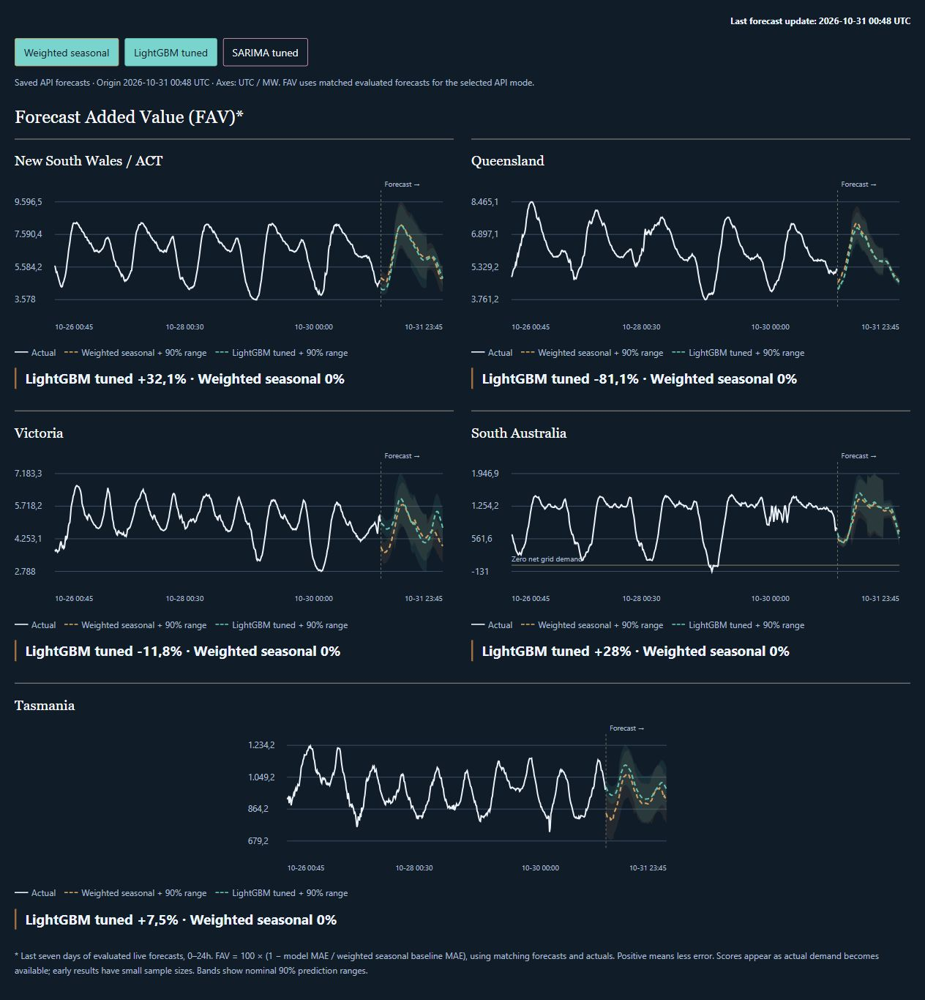

# Gridcast — Australian Electricity Demand Forecasting

[**Explore the interactive project →**](https://tpduarte.com/projects) · [Full dashboard](https://tpduarte.com/dashboard) · [Methodology](https://tpduarte.com/methodology)

Hourly electricity demand forecasts across five Australian regions, with model comparisons and performance tracked against actual demand.

[](https://tpduarte.com/regional-preview)

*Static snapshot of saved forecasts issued on 31 October 2026 at 00:48 UTC (30 October at 21:48 BRT). Click the image to explore the interactive charts, hover over values and toggle models. The screenshot does not refresh automatically; current forecasts and evaluation results are available on the site. Early live FAV scores reflect a small sample and differ from the separate held-out backtest.*

GitHub README pages do not support the JavaScript/iframe embedding required by these charts. The interactive version runs on the existing Cloudflare site; this linked preview requires no additional hosting service.

Source-only release for hourly forecasts of NSW, Queensland, Victoria, South Australia and Tasmania. Regional forecasts are summed to produce the NEM total.

## Model release

The locked LightGBM configuration uses 250 trees, learning rate 0.04, 31 leaves, maximum depth 6, minimum 80 observations per leaf, L2 regularization 10, `linear_tree=true`, and `linear_lambda=10`. Numeric inputs are standardized using training data only. Forecasts recursively cover the next 24 hours in 15-minute intervals.

Configuration selection used 12 monthly expanding-window validation folds, followed by a separate test month. This repository contains the selected parameters and reproducible tuning code; private research outputs and fitted model files are excluded. The weighted seasonal baseline and SARIMA comparator remain available. Inference loads saved models; it does not retrain every hour.

## Deployment

- GitHub Actions: hourly ingestion, inference, saved forecast vintages, delayed evaluation and drift monitoring.
- Private Cloudflare R2: model bundles, actuals, forecasts, scores and derived dashboard snapshots.
- Cloudflare Worker: read-only JSON/CSV API; no model execution in the Worker.
- Portfolio: connect its public API URL after the API passes health and CORS checks.

The hourly and monthly training workflows are disabled until repository variable `GRIDCAST_ENABLED` is explicitly set to `true`. Both share a single-writer concurrency group.

Repository secrets: `R2_ACCESS_KEY_ID`, `R2_SECRET_ACCESS_KEY`. Repository variables: `R2_ENDPOINT`, `R2_BUCKET`. Use a token scoped to this project's private bucket. Configure the exact portfolio origin and R2 binding in `deployment/cloudflare/wrangler.jsonc`.

Before activation, backfill observations to the present, fit the selected configuration and bootstrap the private store. Freshness checks reject stale observations/models; they must not be bypassed to make a historical sample appear live. See [deployment guide](CLOUDFLARE-HOURLY.md).

## Local verification

```sh
python -m pip install -r requirements-cloud.txt
python -m unittest discover -s tests -v
node tests/test_worker.mjs
```

The included runtime tests generate their own fixtures. Audits that depend on the original large historical sample and its SQLite ledgers remain in the separate research workspace. `SOURCE-MANIFEST.json` records the copied runtime source hashes.

No credentials, personal portfolio assets, fitted models, downloaded observations or private experimental reports belong in this repository. The repository is prepared for publication; its existence does not mean that cloud resources or an active schedule have been created.
